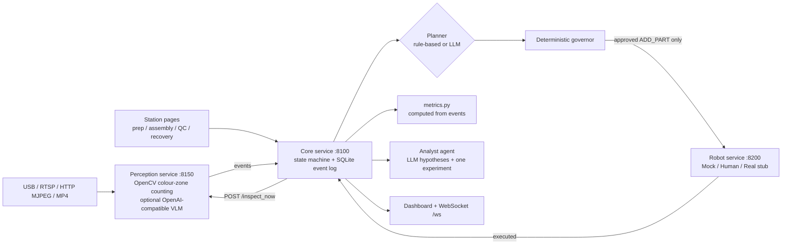

# assembly-line-defect-recovery

[](https://github.com/MadanMohan0537/assembly-line-defect-recovery/commits/main)


Camera-based kit inspection for a small assembly line. It holds incomplete kits before they reach assembly, routes a single-part fix through a deterministic check, re-inspects the kit, and computes line metrics from a replayable event log.

Built as a team project at the NVIDIA Spark Hack Seattle hackathon. The Python services, the dashboard and station pages, and the default SQLite path (`runs/forgemind.sqlite`) still use the original name, **ForgeMind**.

---

## The problem and who it's for

On a multi-station line, the station where work piles up is often not the station where the problem started. Say the kit-prep station sends out a kit with a wheel missing. Assembly stalls on that kit, QC sits idle, and people start fixing the wrong station. Later on, it is hard to say what actually happened, because the evidence is spread across people's memories.

This prototype is aimed at **line supervisors, process and quality engineers, and operations teams** who need to:

1. catch an incomplete kit before it propagates downstream,
2. fix it in a controlled way, without handing an AI model direct control of an actuator,
3. confirm the fix before the line continues, and
4. compare runs (before and after a process change) with numbers computed from recorded events instead of from someone's impression.

## Approach



- **Everything is an event.** Station button presses, perception detections, planner proposals, governor decisions, and recovery results are appended to a SQLite event store (`services/core/db.py`). The default file is `runs/forgemind.sqlite` (gitignored). A kit changes state only through the table in `services/core/state_machine.py`.
- **Deterministic perception first.** OpenCV counts three part types inside calibrated zones (`services/perception`): `red_body`, `black_wheel`, and `blue_roof`. A complete kit is 1 body, 2 wheels, and 1 roof. `SOURCE` can be a USB index (`0`), an RTSP URL, an HTTP MJPEG URL, or an MP4 path. An OpenAI-compatible vision-language model can be added as a second opinion (`services/perception/verify.py`). `scripts/serve_cosmos.sh` is written for a local Cosmos Reason2 server; the client itself just needs `VLM_URL` and `VLM_MODEL`.
- **The model proposes, code decides.** A planner proposes one of `ADD_PART`, `HOLD_FOR_HUMAN`, or `RELEASE`. The default planner is the LLM when the OpenAI client imports, and the rule planner otherwise. If an LLM call fails during a recovery, core uses the rule planner for that kit. The governor (`services/core/governor.py`) is a pure function. For `ADD_PART` it checks that the kit ids match, the part is supported and actually missing, quantity is exactly 1, the source bin matches that part, the target is `inspection_zone`, confidence is at least `GOV_CONF_THRESHOLD` (default 0.85), the robot is `idle` or `done`, and `retry_count` is within `GOV_MAX_RETRIES` (default 1). It also checks `kit_in_inspection_zone`, `workspace_clear`, and `estop_available`. Core fills the first two from perception telemetry when telemetry has arrived, and otherwise passes `true`. It does not set `estop_available`, so that field stays at its schema default of `true`. `RELEASE` is allowed only when the kit is complete and confidence clears the same threshold. `HOLD_FOR_HUMAN` is allowed. Core calls the robot service only for an allowed `ADD_PART`. A denial, a hold, a robot error, or a stalled kit (default 180 seconds) is recorded as `HUMAN_REVIEW_REQUESTED`.
- **Verify before release.** After `RECOVERY_EXECUTED`, core POSTs perception `/inspect_now`. The kit is released only when a following inspection has no missing and no extra parts. A failed re-inspection is retried once, then handed to a person. `baseline` mode records inspections and does not hold or recover.
- **Numbers come from code.** `services/core/metrics.py` computes run metrics from the event log. The analyst LLM reads that event log and those metrics. It does not calculate them. Code drops hypotheses that lack a real supporting event id, and an experiment must be one of the four allowlisted process changes in `services/core/prompts.py`.

## What exists today (verified against the code)

| Component | What is implemented |
|---|---|
| Core service (`services/core`) | FastAPI app on port 8100: event ingest, run start/end/resume, kit state machine, stall watchdog, governor, metrics, and `GET /metrics/compare?before=&after=` (field deltas plus `intervention_reduction`). `POST /analysis/hypotheses/{run_id}`, `POST /analysis/experiment/{run_id}`, and `POST /analysis/verify` call the LLM. They return 503 when the OpenAI client failed to import. With the client installed and no model server, those calls return 500. `GET /analysis/{run_id}` and `POST /analysis/submit/{run_id}` do not need a model. Optional `FORGE_TOKEN` gate: off by default; when set, non-GET requests from non-loopback hosts need header `X-Forge-Token` or `?token=`. Loopback stays exempt unless `FORGE_TRUST_LOOPBACK=0`. WebSocket feed at `/ws`. |
| Web UI | Operator dashboard at `/` and `/dashboard`. One station page switches on `/station/alice` (kit prep), `/station/bob` (assembly), `/station/charlie` (QC), and `/station/recovery`. Page titles still say ForgeMind. |
| Perception service (`services/perception`) | OpenCV zone and colour counting from USB, RTSP, HTTP MJPEG, or an MP4 replay. Calibration page at `/calibrate` on port 8150. Optional VLM client. |
| Robot service (`services/robot`) | One whitelisted routine, add one part, on port 8200. Adapters: `MockArm` (sleeps, then succeeds), `HumanArm` (shows the instruction on the recovery page and waits until someone taps **DONE — part placed**), `RealArm` (a stub whose constructor raises `NotImplementedError`). Default adapter is `human`. |
| Analyst agent (`services/agent`) | Loop that reads a finished run from core, asks the LLM for hypotheses and one experiment, and submits them. `services/agent/openshell_policy.yaml` is marked DRAFT and is not applied by this code. `--demo-denial` tries a robot call, an internet GET, and a write outside the workspace, then posts whatever failed to `/policy/denied`. Core stores that report with `verified_by_core: false`. |
| Open-data analysis (`scripts/open_data_ai4i.py`) | Same split on the public UCI AI4I 2020 predictive-maintenance dataset: code computes the statistics, the configured LLM proposes hypotheses as column predicates, and code checks each one. |
| Synthetic runner (`scripts/synthetic_run.py`) | Drives a running core service through `baseline`, `recovery`, and `improved` without a camera. Default length is 12 kits. |

**Not implemented:** control of a physical robot arm (`RealArm` raises `NotImplementedError` in its constructor) and any robot simulator. The recovery actuator implemented for this hackathon is a person following the on-screen instruction (`HumanArm`).

## How success would be measured

`services/core/metrics.py` already computes these per-run fields from the event log:

- **Escapes and escape rate:** a kit whose latest inspection was incomplete, then received at assembly with no verified recovery in between. Kits that were never inspected are not counted as escapes. Escape rate is escapes ÷ incomplete kits.
- **Recovery success rate:** `RECOVERY_VERIFIED` events ÷ `RECOVERY_APPROVED` events.
- **Human reviews and policy denials.**
- **Throughput per minute** (QC-approved kits ÷ run minutes), **average cycle time**, **assembly idle time**, **maximum queue**, **defect rate** (QC rejects ÷ QC decisions), plus duration, kits started and inspected, correct / rejected / unfinished counts, rework seconds, and a missing-part histogram.
- **Before/after comparison** of two runs, including intervention reduction: `(before.recovery_attempts - after.recovery_attempts) / before.recovery_attempts` when the before-run had any approved recoveries.

**Line performance: not yet measured.** `docs/SUBMISSION_CHECKLIST.md` leaves "Run the three eight-kit physical trials under the same conditions" unchecked. `docs/PHYSICAL_RIG.md` names those trials baseline, recovery, and improved. The repository contains no committed run database (`runs/*.sqlite*` is gitignored).

`scripts/synthetic_run.py` can print the same fields. Its defects are hardcoded: in `baseline` and `recovery`, kits 3, 7, and 11 are each missing one wheel; in `improved`, only kit 8 is. Those prints are a rehearsal of the script, and they are not a measurement of a line.

Committed artifacts that do exist:

- `runs/open_data_ai4i.md` and `runs/open_data_ai4i.json`: 10,000 rows of the AI4I 2020 dataset, overall failure rate 0.0339 (3.39%). Of the four hypotheses stored in that file, the code check supported high tool wear with a recorded lift of 3.06, did not support two others, and marked one inconclusive. The file does not name the model that wrote the hypotheses. This is one analysis of a public dataset. A fresh `python scripts/open_data_ai4i.py --download` reproduces the `stats` object and then rewrites both files without the hypothesis section.
- `docs/SPARK_STORY.md`: one-off compute notes for the GB10 Grace Blackwell demo (local LLM tokens/s, VLM latency per clip, memory use). Perception pipeline fps and kit-inspect-to-decision latency are marked pending in that file. Those notes were not remeasured for this README.

## Limitations

- Hackathon prototype. `docs/PHYSICAL_RIG.md` describes a miniature tabletop with three part types. The build plan's physical-set item, still unchecked, mentions flat paper parts. The three eight-kit physical trials are unchecked, and this has no committed production-line trial.
- No physical robot control. `RealArm` is a stub. No robot simulator is in this repository. The governed recovery step that is implemented waits for a person (`HumanArm`) or sleeps (`MockArm`).
- The governor and the event log make behaviour inspectable. They are not a safety certification. `estop_available` is not wired to a live stop signal; the orchestrator leaves it true. `workspace_clear` and "kit in zone" also default to true until perception reports them.
- Analyst output is a set of hypotheses tied to event ids, not a proven cause.
- Perception depends on the HSV ranges and zone polygons in `services/perception/config/`, plus lighting and camera placement.
- The optional token is a shared secret for state-changing HTTP calls from other devices. GETs are ungated. It is not authentication.
- LLM and VLM features need OpenAI-compatible servers that you start yourself (`scripts/serve_cosmos.sh`, `scripts/serve_lightning.sh`, `scripts/serve_super.sh`). `scripts/start_all.sh` does not install or start them. With the client library present and the server down, model routes return 500.
- `openshell_policy.yaml` is a draft. This repository does not enforce it, and a row in `/policy/denied` is a report, not proof of a sandbox.
- No license file is included yet.

## Quick start

**Requirements:** Python 3.10 or newer (the code uses `X | Y` type unions). A GPU and model servers are only needed for the LLM and VLM features.

```bash
git clone https://github.com/MadanMohan0537/assembly-line-defect-recovery.git
cd assembly-line-defect-recovery
python3 -m venv .venv
source .venv/bin/activate        # Windows: .venv\Scripts\activate
pip install -r requirements.txt
python -m pytest -q              # 62 tests, the core suite in pytest.ini
python -m pytest -q services/core/tests services/agent/tests services/perception/tests
                                 # 70 tests: core 62, perception 7, agent 1
```

### Rehearsal without a camera, GPU, or model

Perception is not required here. The script posts the inspection events itself. Set the variables on each process: core reads `PLANNER` at startup, and the robot service reads `ROBOT_ADAPTER` at startup (its default is `human`).

```bash
# terminal 1
PYTHONPATH=$PWD PLANNER=rule uvicorn services.core.main:app --host 0.0.0.0 --port 8100
# terminal 2
PYTHONPATH=$PWD ROBOT_ADAPTER=mock uvicorn services.robot.main:app --host 0.0.0.0 --port 8200
```

Then drive it and open `http://localhost:8100/dashboard`:

```bash
PYTHONPATH=$PWD python scripts/synthetic_run.py --mode baseline --fast
PYTHONPATH=$PWD python scripts/synthetic_run.py --mode recovery --fast
PYTHONPATH=$PWD python scripts/synthetic_run.py --mode improved --fast
```

`--fast` shortens the script's own sleeps. The default is 12 kits. `--kits 8` stops before kit 11, so the baseline/recovery pattern then includes only kits 3 and 7. With `ROBOT_ADAPTER=human`, someone has to tap **DONE — part placed** on `/station/recovery`, or you can pass `--auto-human`.

### Full stack (camera + local models)

`scripts/start_all.sh` starts core (:8100), robot (:8200), and perception (:8150), and the agent watcher when `AGENT_WATCH=1`. Its defaults are an RTSP source (`rtsp://127.0.0.1:8554/line`), `ROBOT_ADAPTER=human`, `PLANNER=llm`, an OpenAI-compatible LLM at `http://127.0.0.1:8000/v1` (model name `super`), and a VLM at `http://127.0.0.1:8001/v1` (model name `cosmos`). Start those servers separately.

```bash
bash scripts/start_mediamtx.sh &                     # local RTSP relay; phone publishes to :8554/line
PLANNER=rule ROBOT_ADAPTER=human bash scripts/start_all.sh
bash scripts/check_env.sh                            # OK/DOWN for core, perception, robot, model ports, Ollama, and the RTSP relay
```

| Page | URL |
|---|---|
| Dashboard | `http://localhost:8100/dashboard` |
| Stations | `http://localhost:8100/station/alice` · `/bob` · `/charlie` · `/recovery` |
| Perception calibration | `http://localhost:8150/calibrate` |

### Open-data analysis

```bash
python scripts/open_data_ai4i.py --download   # download the UCI CSV if needed, print stats, no model
python scripts/open_data_ai4i.py              # also ask the LLM for hypotheses and check them
```

Both commands rewrite `runs/open_data_ai4i.json` and `runs/open_data_ai4i.md`. `--download` leaves out the hypothesis and verdict sections. The CSV is written to `data/open/ai4i2020.csv`, which is gitignored.

## Documentation

- [Core service guide](docs/CORE.md): API, environment variables, token guard
- [Demo script](docs/DEMO_SCRIPT.md)
- [Physical rig](docs/PHYSICAL_RIG.md)
- [VLM / video search setup](docs/VSS_SETUP.md)
- [Analyst agent](services/agent/README.md)

## License

No license file is included yet. Because this is a team project, all contributors need to agree on a license before the code is reused or redistributed.
